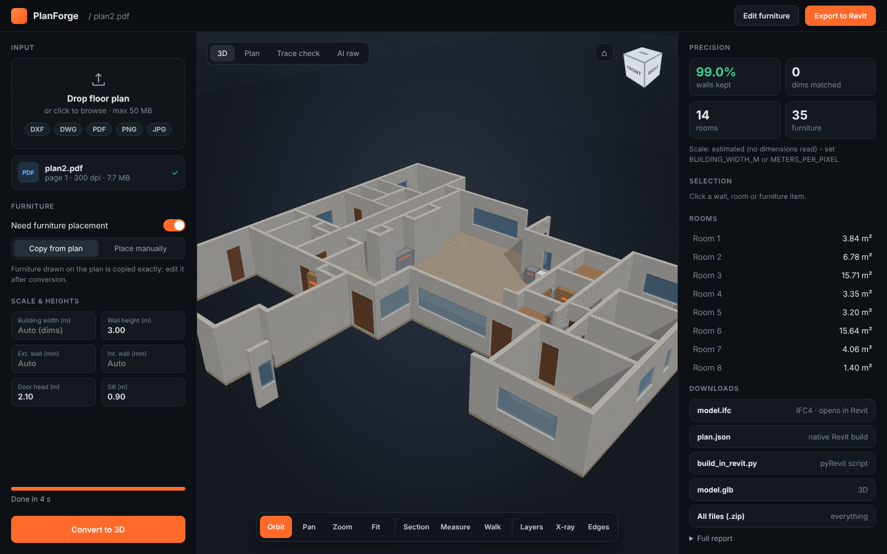
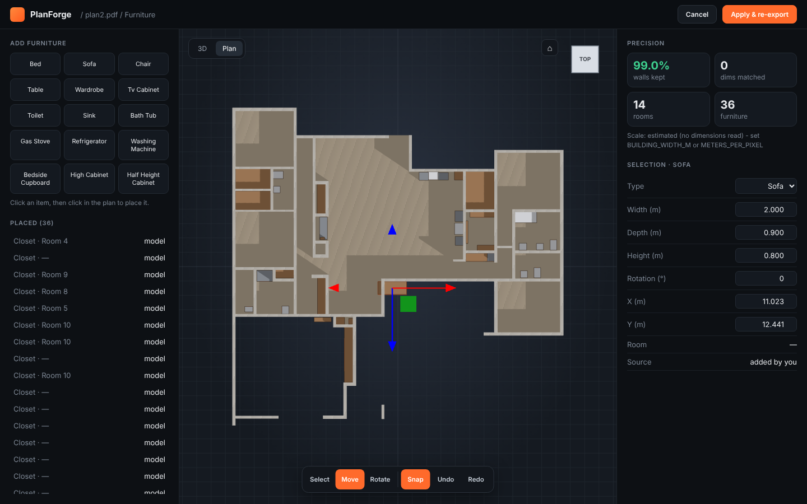
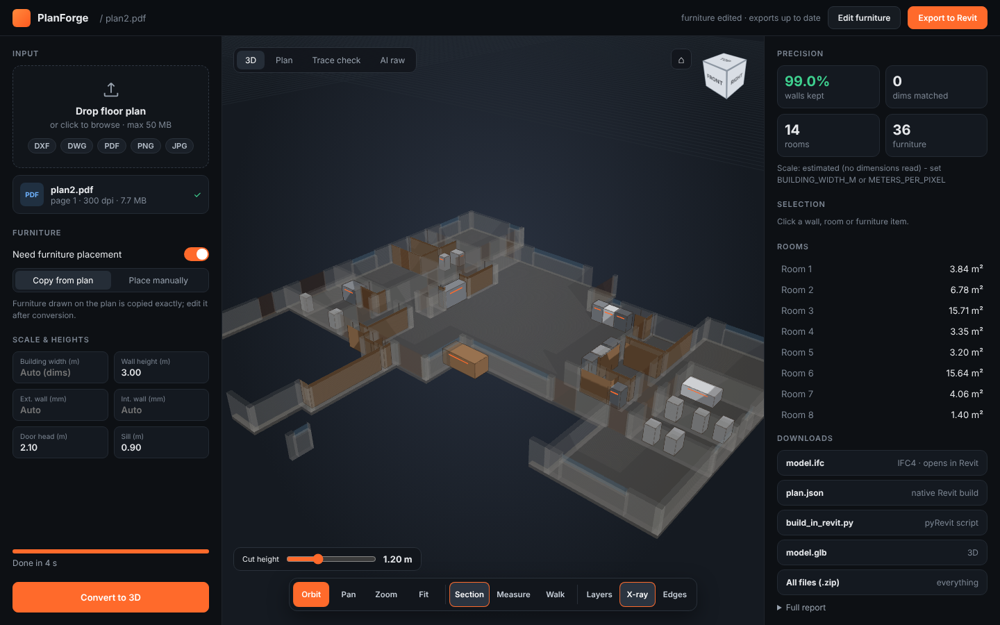

# PlanForge — 2D floor plan → exact 3D BIM & Revit

Upload a floor plan (**DXF, PDF, PNG or JPG**) and get a measured 3D building model: walls, doors, windows,
stairs, rooms and furniture, exported as **IFC4**, **glTF** and a **native Revit build script**.
Architects then only add elevations and detailing, which cuts most of the manual modelling work.

**Live demo:** _add your Modal link here_ · built by [@gogul098](https://github.com/gogul098)



| Furniture editor | Section + X-ray |
|---|---|
|  |  |

## What it does

- **Any input:** DXF is rasterised at its true drawing units, so the scale is exact. PDF and images are scaled
  from the dimension strings and room sizes written on the plan, read by OCR and solved by least squares.
- **Floor-plan model:** a multitask U-Net (EfficientNet-B3, 768 px) segments 12 room classes and 12 icon
  classes (walls, doors, windows, stairs, fixtures). Best validation score 0.747.
- **Furniture detector:** YOLO11m-OBB trained on FloorPlanCAD (18 classes, mAP50 ≈ 0.87). It keeps the exact
  rotation, checks each object against the room it sits in, and snaps it back against the nearest wall.
- **Vectorisation:** masks become centre-line walls with snapped thicknesses, joined corners and openings hosted
  in walls. On the test plans, 99% of predicted wall pixels end up in BIM walls.
- **Exports:**
  - `model.ifc`: IFC4 with wall types, doors, windows, spaces, slab, stairs and furniture.
  - `plan.json` + `build_in_revit.py`: builds native Revit walls, doors, windows, floors, rooms, grids and
    furniture (pyRevit / RevitPythonShell).
  - `model.glb`: the 3D model as glTF.
- **Web app:** a BIM-style viewer (orbit, pan, view cube, section cut, measure, walk, layers, X-ray), a
  "need furniture placement" switch, and a furniture editor (add, move, rotate, swap, delete, undo) that
  re-exports every file.

## How it works

```
plan ─► U-Net (rooms + icons) ─► vectorise walls/openings ─► OCR dimensions ─► solve exact scale
     └► YOLO-OBB furniture ─► room check ─► wall snapping ─┘
                                   ▼
          plan.json ─► IFC4 · glTF · Revit script ─► web viewer / editor
```

## Repository

| Path | What |
|---|---|
| `app/` | FastAPI backend (`server.py`), pipeline (`pipeline.py`), web frontend (`static/`, three.js) |
| `modal_app.py` | Serverless GPU deployment on Modal |
| `pipeline/` | Pipeline source modules (`assemble.py` builds the single-file `pipeline.py`) |
| `training/` | Kaggle notebooks + training code for both models (2× T4, DDP, fp16, EMA) |
| `revit/` | `build_in_revit.py`: builds the model in Revit from `plan.json` |
| `kaggle/` | Diagnostics and a run-on-Kaggle cell |
| `.github/workflows/deploy.yml` | Every push to `main` redeploys the site |

## Run locally

```bash
pip install -r app/requirements.txt torch torchvision
export HF_TOKEN=...            # read access to the model repos
cd app && uvicorn server:app --port 7860
```

## Deploy (GitHub → Modal, free monthly credit)

1. Create a Modal account → Settings → API Tokens → new token.
2. In this repo: Settings → Secrets and variables → Actions → add `MODAL_TOKEN_ID`, `MODAL_TOKEN_SECRET` and
   `HF_TOKEN`.
3. Push to `main` (or Actions → *Deploy to Modal* → Run). The link appears in the action log:
   `https://<modal-user>--planforge-web.modal.run`.

## Credits & licence

Code: MIT. Models trained on [CubiCasa5K](https://github.com/CubiCasa/CubiCasa5k) and
[FloorPlanCAD](https://floorplancad.github.io/) (CC BY-NC 4.0): non-commercial use only.
